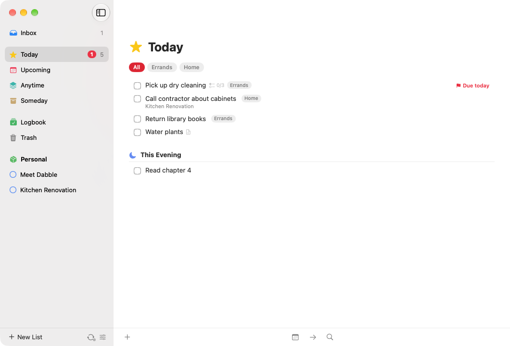
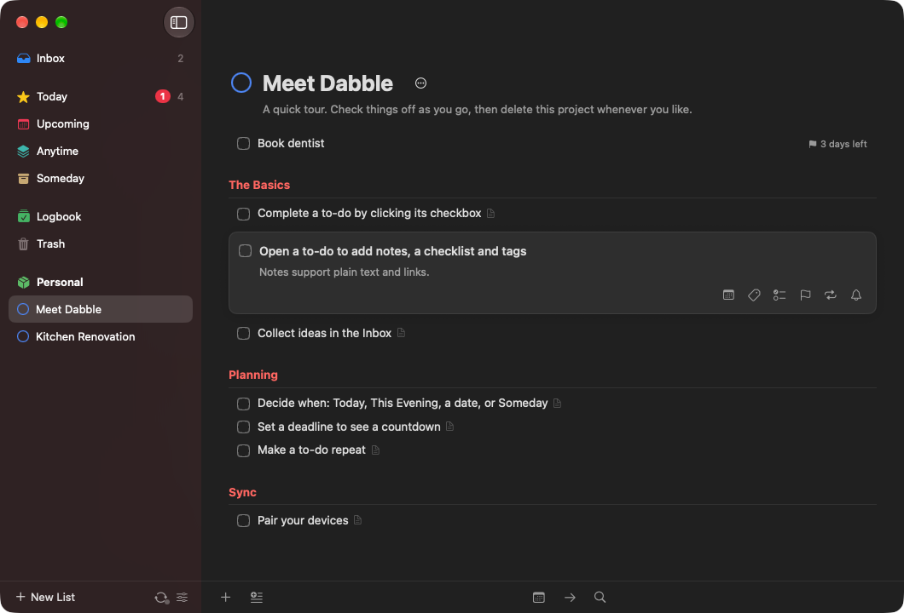
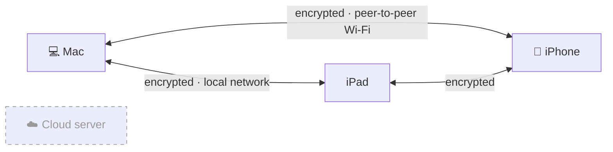
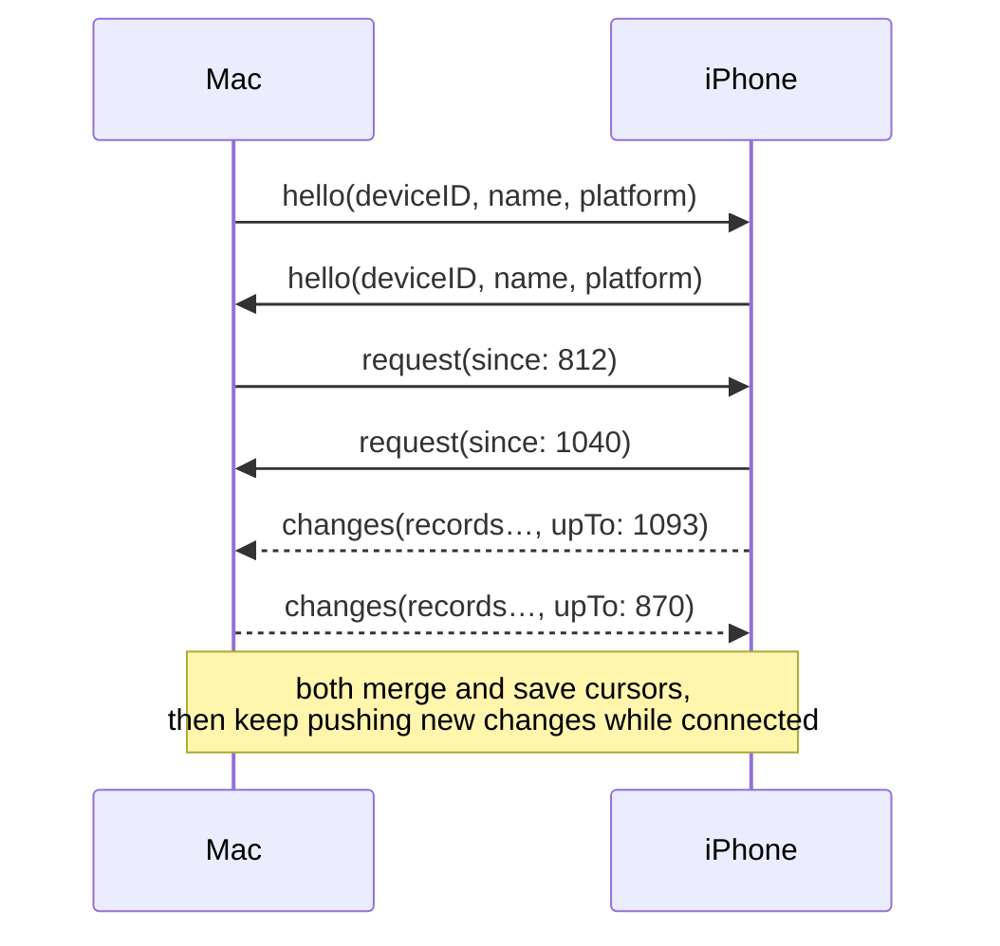

<p align="center">
  
</p>

<h1 align="center">Dabble</h1>

<p align="center">
  <strong>A beautiful, open-source to-do app for Mac, iPhone and iPad.</strong><br>
  Your devices sync with each other. No server, no account.
</p>

<p align="center">
  <a href="https://github.com/nearbycoder/dabble/releases/latest/download/Dabble-macOS.zip"><b>Download for Mac</b></a> ·
  <a href="#iphone--ipad">iPhone &amp; iPad</a> ·
  <a href="https://nearbycoder.github.io/dabble/">Website</a> ·
  <a href="#how-sync-works">How sync works</a>
</p>

<p align="center">
  <a href="https://github.com/nearbycoder/dabble/actions/workflows/ci.yml"></a>
  <a href="https://github.com/nearbycoder/dabble/releases/latest"></a>
  <a href="LICENSE"></a>
</p>

---

Dabble is a native SwiftUI to-do app modeled on [Things 3](https://culturedcode.com/things/): Inbox, Today, Upcoming, Anytime, Someday, projects with headings, areas, tags, checklists, deadlines and repeating to-dos. The difference is sync. There's no cloud. Your Mac, iPhone and iPad find each other on your network and exchange changes directly over an encrypted channel. Every device holds the full list and works offline.

<p align="center">
  
  
</p>
<p align="center">
  
  
</p>

## Contents

- [Features](#features)
- [Download & install](#download--install)
- [How sync works](#how-sync-works)
- [Privacy](#privacy)
- [URL scheme](#url-scheme)
- [Keyboard shortcuts](#keyboard-shortcuts)
- [Building from source](#building-from-source)
- [Project layout](#project-layout)
- [Roadmap](#roadmap)
- [Contributing](#contributing) · [Security](#security) · [License](#license)

## Features

**Organize**
- **Inbox** for anything you haven't sorted yet
- **Areas** (Work, Home, …) holding projects and loose to-dos
- **Projects** with **headings** and a progress pie
- **Checklists** and notes on every to-do
- **Tags**, nested, inherited from a to-do's project and area, with a tag filter on every list
- **Logbook** of completed items and a **Trash** you can restore from

**Plan**
- **Today** with a separate **This Evening** section
- **Upcoming**: the days and weeks ahead, including future repeats
- **Anytime** and **Someday**
- **When** dates with natural-language entry: `today`, `tonight`, `tom`, `fri`, `next week`, `in 3 days`, `Dec 25`, `2027-01-15`, …
- **Deadlines** with a countdown ("2 days left")
- **Reminders** delivered as local notifications
- **Repeating to-dos**, on a schedule or a set time after completion

**Capture & find**
- **Quick Find** for jumping to any list, project, tag or to-do
- **`dabble:///` URL scheme** for automation ([reference](#url-scheme))
- **JSON backup** export and import

**Mac**
- **Quick Entry** from any app with a global hotkey
- Full **keyboard shortcuts** ([list](#keyboard-shortcuts))
- Drag and drop, multi-select, undo

**iPhone & iPad**
- **Magic Plus** button: tap to add, or drag to drop a new to-do exactly where you want it
- **Swipe actions** to schedule, move or delete
- Drag and drop reordering, multi-select, undo

**Sync**
- Device-to-device over Wi-Fi, Ethernet or Apple's peer-to-peer Wi-Fi (no router needed)
- Optional manual addresses, e.g. over [Tailscale](https://tailscale.com), for syncing away from home
- Pair with a 6-digit code; no account
- Conflict-free merging, field by field
- Light and dark mode everywhere

## Download & install

### Mac

Requires macOS 15 Sequoia or later.

1. Download **[Dabble-macOS.zip](https://github.com/nearbycoder/dabble/releases/latest/download/Dabble-macOS.zip)** (or the **[.dmg](https://github.com/nearbycoder/dabble/releases/latest/download/Dabble-macOS.dmg)**) from the [latest release](https://github.com/nearbycoder/dabble/releases/latest).
2. Move **Dabble.app** to **Applications**.
3. **First launch:** release builds are ad-hoc signed, not notarized by Apple, so Gatekeeper will stop the first launch. Use one of:
   - Right-click **Dabble.app → Open**, then confirm.
   - Try to open it once, then **System Settings → Privacy & Security → Open Anyway**.
   - In Terminal: `xattr -dr com.apple.quarantine /Applications/Dabble.app`

Each release includes `SHA256SUMS.txt` so you can check what you downloaded: `shasum -a 256 -c SHA256SUMS.txt`.

### iPhone & iPad

Requires iOS / iPadOS 18 or later. Dabble isn't on the App Store, so there are two options.

**Build it with Xcode** (a free Apple ID is enough):

1. Install Xcode 26 or later.
2. `git clone https://github.com/nearbycoder/dabble.git && open dabble/Dabble.xcodeproj`
3. Select the **DabbleiOS** scheme. Under **Signing & Capabilities**, choose your team. If Xcode complains about the bundle identifier, change `com.nearbycoder.dabble` to something unique.
4. Connect your device, select it as the run destination and press **Run**. Enable **Developer Mode** on the device if prompted.

**Sideload the release build:** download **[Dabble-iOS-unsigned.ipa](https://github.com/nearbycoder/dabble/releases/latest/download/Dabble-iOS-unsigned.ipa)** and install it with [AltStore](https://altstore.io) or [Sideloadly](https://sideloadly.io). They re-sign the app with your Apple ID. Then trust the profile under **Settings → General → VPN & Device Management**.

> Apps signed with a free Apple ID expire after 7 days. Re-run from Xcode or refresh in AltStore. Your data is kept.

## How sync works

Dabble has no server. Each device keeps a complete copy of your data and syncs directly with the other devices in its **sync group**.



There is no cloud server in that picture. The dashed box is only there to show what's missing.

### 1. Data model: a CRDT of last-writer-wins fields

Everything (to-dos, projects, areas, headings, tags, checklist items) is a **record**: an id, a kind, and a bag of independently versioned **fields** (`Packages/DabbleKit/Sources/DabbleKit/Model/Record.swift`).

- Every field write is stamped with a **hybrid logical clock** (HLC): wall-clock milliseconds, a counter, and the device id (`Model/HLC.swift`). HLCs stay monotonic even if a device's clock jumps backwards, and a device advances its clock past any timestamp it receives.
- Merging two copies of a record keeps, **per field**, the value with the greater timestamp. Ties break on device id. That merge is commutative, associative and idempotent, so devices converge however, whenever and through whichever path they exchange records. Rename a to-do on the Mac and set its deadline on the iPhone while both are offline, and you keep both changes.
- Deletes are fields too (to-dos move to the Trash), so they sync like any other edit.
- **Repeating to-dos** create the next instance with a **deterministic id** derived from the series and the date. If two offline devices both complete the same repeat, they create the *same* next to-do, and it merges into one.

### 2. Delta sync with sequence numbers

Each device numbers its local changes with an increasing **sequence number** (`seq`). When a record changes, locally or by merging something new from a peer, it gets the next `seq`.

For each peer, a device remembers a **cursor**: the highest `seq` of theirs it has merged. On connect it asks *"everything since seq N"*, receives only what changed (in chunks of 500 records), and advances the cursor. While connected, new changes are pushed within ~300 ms.

Because merged changes get a fresh local `seq`, changes **relay transitively**. If the iPad syncs with the Mac, and later the Mac syncs with the iPhone, the iPhone gets the iPad's edits even though the two never met.



### 3. Discovery

- **Bonjour** service `_dabble._tcp`, with a TXT record carrying the device id and a short fingerprint of the sync group, so devices only dial members of their own group.
- **Apple peer-to-peer Wi-Fi (AWDL)** is enabled on every listener and connection, so a Mac and an iPhone can sync with no router, e.g. on a train.
- **Manual addresses** (`host:port`) for networks where Bonjour doesn't reach, such as a VPN like [Tailscale](https://tailscale.com): `my-mac.tailnet.ts.net:52384`.
- The default port is **52384**. If it's taken, Dabble falls back to any free port (shown in Settings → Sync).
- Known peers are re-dialed every 15 seconds and whenever the app returns to the foreground. If two devices dial each other at once, they keep exactly one connection.

### 4. The secure channel

Each connection is wrapped in a small authenticated-encryption protocol (`Sync/SecureChannel.swift`):

1. Both sides send `version ‖ 32 random bytes ‖ ephemeral X25519 public key`.
2. Both compute the **X25519 shared secret** and derive two directional keys with
   `HKDF-SHA256(ikm: ECDH secret ‖ 256-bit group key, salt: both hellos in sorted order, info: "dabble/v1/<purpose>")`.
3. All further frames are length-prefixed **ChaCha20-Poly1305** ciphertexts whose nonce is a per-direction counter, so frames can't be replayed, reordered or dropped without detection.

Mixing in the ephemeral ECDH secret gives **forward secrecy**: a recorded session can't be decrypted later, even by someone who steals the group key. Mixing in the group key means only devices in the group can complete a session. A wrong key shows up as the first message failing to decrypt.

### 5. Pairing

1. On a device, **Settings → Sync → Pair New Device** creates a sync group (a random 256-bit key) if there isn't one yet, and shows a **6-digit code** for 5 minutes. It advertises `_dabble-pair._tcp`.
2. On the new device, pick that device from the list and enter the code.
3. The two open the same secure channel, keyed with `SHA-256("dabble-pairing|" + code)` instead of the group key. If the code matches, the host sends the group key over that channel and the new device joins. Existing data on both devices is merged, not replaced.

The code rotates after 5 failed attempts. Read [SECURITY.md](SECURITY.md) for the limits of this scheme. In short, pair on a network you trust; replacing it with a PAKE is on the [roadmap](#roadmap).

### Limitations

- **Both apps need to be open.** iOS doesn't allow background networking for this kind of sync, so the iPhone and iPad catch up when you open Dabble. The Mac syncs whenever it's running.
- Devices sync with peers they can reach. Two devices that never share a network (or a VPN) will only converge through a third device that meets both.

## Privacy

Dabble collects nothing. There is no server, account, analytics, crash reporting or tracking.

- Your data is a JSON file (`dabble.json`) in the app's sandboxed container, under `Library/Application Support/Dabble/`. On the Mac that's `~/Library/Containers/com.nearbycoder.dabble/Data/Library/Application Support/Dabble/`.
- The sync group key and known peers are in `sync.json` next to it.
- The only network traffic is between your own devices (and Bonjour announcements on your local network).
- Reminders are local notifications; no push service is involved.

See also the [privacy page](https://nearbycoder.github.io/dabble/privacy.html).

## URL scheme

Dabble understands `dabble:///` URLs, modeled on Things' `things:///`. Parameters are URL-encoded. Use `%0A` (newline) to separate items in lists.

| Command | Parameters | Example |
|---|---|---|
| `add` | `title` (required, or `titles`: several titles separated by newlines) · `notes` · `when` (`today`, `evening`, `tomorrow`, `someday`, `anytime`, `fri`, `in 3 days`, `2026-12-01`, …) · `deadline` · `tags` (comma-separated, created if missing) · `list` (a project or area name or id, or `inbox`, `today`, `anytime`, `someday`, …) · `list-id` · `heading` (inside the project in `list`) · `checklist-items` (newline-separated) · `completed=true` · `reveal=true` | `dabble:///add?title=Buy%20milk&when=today&tags=Errands` |
| `add-project` | `title` (required) · `notes` · `area` (name) or `area-id` · `when` · `deadline` · `tags` · `to-dos` (newline-separated) · `reveal=true` | `dabble:///add-project?title=Trip&area=Personal&to-dos=Book%20flight%0APack` |
| `show` | `id`: a to-do, project, area or tag id; a built-in list (`inbox`, `today`, `upcoming`, `anytime`, `someday`, `logbook`, `trash`); or a project or area name | `dabble:///show?id=today` |
| `search` | `query` | `dabble:///search?query=milk` |

Try it from Terminal: `open "dabble:///add?title=Call%20Mom&when=tonight"`.

## Keyboard shortcuts

The Mac app follows the keyboard conventions of Things.

| Create & find | | Selected to-dos | | Go to | |
|---|---|---|---|---|---|
| New to-do | <kbd>⌘N</kbd> | Open / edit | <kbd>Return</kbd> | Inbox | <kbd>⌘1</kbd> |
| New to-do below selection | <kbd>Space</kbd> | Complete | <kbd>⌘K</kbd> | Today | <kbd>⌘2</kbd> |
| New project | <kbd>⌥⌘N</kbd> | When… | <kbd>⌘S</kbd> | Upcoming | <kbd>⌘3</kbd> |
| New heading | <kbd>⇧⌘N</kbd> | Start Today / This Evening | <kbd>⌘T</kbd> / <kbd>⌘E</kbd> | Anytime | <kbd>⌘4</kbd> |
| Quick Entry (any app) | <kbd>⌃Space</kbd> | Anytime / Someday | <kbd>⌘R</kbd> / <kbd>⌘O</kbd> | Someday | <kbd>⌘5</kbd> |
| Quick Find | just start typing | Deadline | <kbd>⇧⌘D</kbd> | Logbook | <kbd>⌘6</kbd> |
| Undo / Redo | <kbd>⌘Z</kbd> / <kbd>⇧⌘Z</kbd> | Tags | <kbd>⇧⌘T</kbd> | Settings | <kbd>⌘,</kbd> |
| | | Move to… | <kbd>⇧⌘M</kbd> | | |
| | | Move up / down | <kbd>⌥⌘↑</kbd> / <kbd>⌥⌘↓</kbd> | | |
| | | Extend selection | <kbd>⇧↑</kbd> / <kbd>⇧↓</kbd> | | |
| | | Move to Trash | <kbd>⌫</kbd> | | |

## Building from source

Requirements: macOS 15 or later and **Xcode 26 or later**.

```sh
git clone https://github.com/nearbycoder/dabble.git
cd dabble
open Dabble.xcodeproj        # schemes: DabbleMac, DabbleiOS
```

`Dabble.xcodeproj` is generated from [`project.yml`](project.yml) with [XcodeGen](https://github.com/yonaskolb/XcodeGen) and committed for convenience. If you change `project.yml` (or add or remove files), regenerate it:

```sh
brew install xcodegen
xcodegen generate
```

- **Mac:** run the `DabbleMac` scheme. It's ad-hoc signed (`CODE_SIGN_IDENTITY = "-"`), so no account is needed.
- **iPhone / iPad:** run the `DabbleiOS` scheme. To run on a device, set your team under Signing & Capabilities.
- **Tests:** the core library has a Swift package test suite.

  ```sh
  cd Packages/DabbleKit
  swift test
  ```

- **Release artifacts:** `scripts/package-release.sh <version> [output-dir]` builds the Release configuration and produces `Dabble-macOS.zip`, `Dabble-macOS.dmg`, `Dabble-iOS-unsigned.ipa` and `SHA256SUMS.txt`. It's what the release workflow runs.

  ```sh
  scripts/package-release.sh 1.0.0 build/release
  ```

### Releasing

Push a tag like `v1.2.0` (or run the **Release** workflow manually with a version). [`.github/workflows/release.yml`](.github/workflows/release.yml) runs the tests, builds and packages both apps with the version from the tag, and publishes a GitHub Release with generated notes. The website's download buttons always point at the latest release.

## Project layout

```
Apps/
  macOS/            Mac app (SwiftUI): windows, menus, Quick Entry, shortcuts
  iOS/              iPhone & iPad app (SwiftUI)
  Shared/           Code and assets used by both apps (AppModel, theme, icon)
Packages/DabbleKit/ The core, a Swift package with no UI
  Sources/DabbleKit/
    Model/          Record (CRDT), HLC, entities, When, Day, RepeatRule
    Store/          DabbleStore, actions, list queries, reminders, URL scheme
    Sync/           SyncEngine (discovery, pairing, delta sync), SecureChannel
  Tests/            Unit tests for the store, merging and sync
docs/               This project's website (GitHub Pages, plain HTML/CSS)
scripts/            make-icon.swift, package-release.sh
project.yml         XcodeGen spec → Dabble.xcodeproj
.github/workflows/  CI, release and Pages workflows
```

## Roadmap

Things features not built yet, plus sync improvements. Contributions welcome.

- [ ] Calendar events in Today and Upcoming
- [ ] Widgets (Home Screen, Lock Screen, desktop)
- [ ] Share extension
- [ ] Apple Watch app
- [ ] Siri and Shortcuts actions beyond the basics
- [ ] Mail to Dabble
- [ ] Import from Things
- [ ] Markdown in notes
- [ ] Background sync on iOS
- [ ] A PAKE (e.g. CPace or SPAKE2) for pairing, so a 6-digit code is safe even against an active attacker
- [ ] Removing a device from a group by rotating the group key

## Contributing

Bug reports, ideas and pull requests are welcome. Please read [CONTRIBUTING.md](CONTRIBUTING.md) first.

## Security

Dabble's threat model, including what pairing does and doesn't protect against, is in [SECURITY.md](SECURITY.md). Please report vulnerabilities privately as described there.

## License

[MIT](LICENSE) © 2026 Dabble contributors.

Dabble is an independent open-source project. It is not affiliated with or endorsed by Cultured Code (makers of Things) or Apple.
